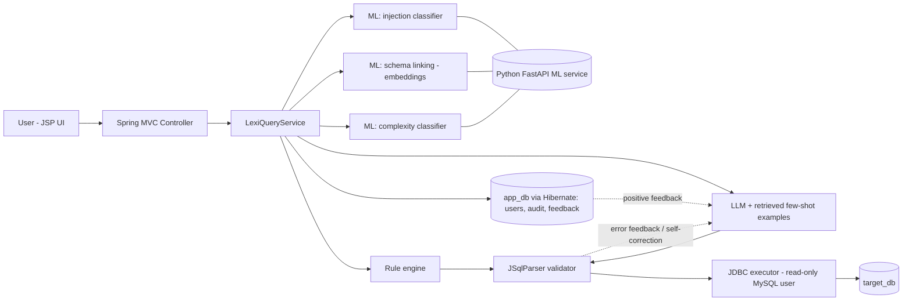

# LexiQuery: Secure, AI-Powered Natural Language to SQL

> Ask your MySQL database questions in plain English. An LLM plus classical ML translates them to SQL, a security layer verifies every query, and a built-in benchmark module measures how well each approach performs.

    

## Why this project
Most natural-language-to-SQL demos execute whatever the model returns. This project treats **the model's output as untrusted input** and combines AI, ML and security engineering in one system, with a research harness to compare approaches.

## Architecture



## AI / ML components
| Component | Technique | Purpose |
|---|---|---|
| SQL generation | LLM with schema-in-prompt | Handles complex joins, aggregations, sub-queries |
| Schema linking | Sentence embeddings (MiniLM) + cosine similarity | Keeps the prompt small and relevant on large schemas |
| Complexity routing | TF-IDF + Logistic Regression | Sends simple questions to cheap rules, hard ones to the LLM (hybrid) |
| Injection detection | Char n-gram TF-IDF + Logistic Regression | Blocks prompt/SQL-injection attempts before they reach the LLM |
| Retrieval-augmented few-shot | Similarity search over user-approved queries | System improves with feedback, no retraining needed |
| Self-correction | Validation/DB errors fed back to the LLM | Fixes wrong columns, bad syntax, disallowed tables automatically |

## Security model (defence in depth)
- Spring Security: BCrypt(12), form login, **CSRF on**, session-fixation protection, HttpOnly + SameSite cookies, CSP and security headers
- Roles `ADMIN` / `ANALYST` / `VIEWER` with per-role table whitelist
- Account lockout after 5 failed logins; per-user rate limiting
- No hard-coded secrets: everything via environment variables; admin password generated at first start if not provided
- **Generated SQL is never trusted:** JSqlParser accepts only one plain `SELECT`; blocks stacked queries, comments, system schemas, dangerous functions, disallowed tables; enforces `LIMIT`
- The target DB connection uses a **SELECT-only MySQL account**, query timeout and max rows
- Output encoded with `<c:out>` (XSS), full audit trail in `query_history`

## Run it locally
**Requirements:** JDK 17 or newer, MySQL 8.0 or newer, and Maven (bundled with IntelliJ IDEA, or install `mvn`). No API key is needed to try it.

**1. Get the code**
```bash
git clone https://github.com/ctnk18/Lexiquery.git
cd Lexiquery
```

**2. Create the databases**
Run `sql/init.sql` once as the MySQL `root` user, either in MySQL Workbench (*File > Open SQL Script*, then the lightning-bolt button) or from a terminal:
```bash
mysql -u root -p < sql/init.sql
```
This creates `lexiquery_app` (application data), `lexiquery_target` (the sample e-commerce data users query), a read-only `lexiquery_ro` account and the application account. Demo passwords are in the script; change them outside local development.

**3. Start the application**

*IntelliJ IDEA (recommended)*
1. *File > Open* the `lexiquery` folder, wait for Maven to import, and use JDK 17+.
2. Enable *Settings > Build, Execution, Deployment > Compiler > Annotation Processors > Enable annotation processing* (needed for Lombok).
3. Select the shared run configuration **LexiQuery** (in `.run/`) and press Run. If MySQL is not on port 3306, edit the configuration and add `APP_DB_URL` and `TARGET_DB_URL` (see the table below).

*Command line*
```bash
# bash
export APP_ADMIN_PASSWORD='ChangeMe#123' APP_DB_PASSWORD=app_pass_change_me TARGET_DB_PASSWORD=ro_pass_change_me LLM_ENABLED=false ML_ENABLED=false
mvn spring-boot:run
```
```powershell
# PowerShell
$env:APP_ADMIN_PASSWORD="ChangeMe#123"; $env:APP_DB_PASSWORD="app_pass_change_me"; $env:TARGET_DB_PASSWORD="ro_pass_change_me"; $env:LLM_ENABLED="false"; $env:ML_ENABLED="false"
mvn spring-boot:run
```
Run it from the folder that contains `pom.xml`, because the JSP pages are located relative to the working directory.

**4. Open the app**
Go to http://localhost:8080 and sign in as `admin`, `analyst` or `viewer`. All three use the password set in `APP_ADMIN_PASSWORD` (`ChangeMe#123` in the run configuration above). Accounts are created on the first start.

**5. Try it**
Choose the **RULE** engine (no API key needed) and ask, for example: `show all customers`, `how many orders`, `top 3 products by price`. Log in as `viewer` and ask for `orders` to see the role-based table check. A request such as `drop table customers` is stopped by the security layer.

### Optional: language model
The LLM and HYBRID engines need a model API key. Any OpenAI-compatible provider works, including free tiers.

| Variable | Purpose | Default |
|---|---|---|
| `LLM_ENABLED` | turn the LLM on | `true` (the shared run configuration sets `false`) |
| `LLM_API_KEY` | provider key (never commit it) | none |
| `LLM_BASE_URL` | provider endpoint | `https://api.groq.com/openai/v1` |
| `LLM_MODEL` | model name | `openai/gpt-oss-120b` |
| `LLM_PROVIDER` | `openai` (compatible API) or `anthropic` | `openai` |
| `ML_ENABLED` | Python ML service (classifiers, schema linking) | `true` (set `false` if you do not run it) |
| `APP_DB_URL`, `TARGET_DB_URL` | JDBC URLs if MySQL is not on port 3306 | `jdbc:mysql://localhost:3306/lexiquery_app?...` |

### Troubleshooting
- **Whitelabel 404 page on `/login`:** the working directory is not the folder containing `pom.xml`.
- **`Access denied for user 'lexiquery_app'`:** `sql/init.sql` was not run, or the password differs from `APP_DB_PASSWORD`.
- **`Unknown database` or table errors on an old MySQL:** use MySQL 8.0 or newer.
- **Cannot sign in:** accounts are only created on the first start. Delete the rows in `lexiquery_app.app_users` and restart to recreate them with the current `APP_ADMIN_PASSWORD`.

## Research evaluation
Admin page > **Run evaluation** executes `src/main/resources/benchmark/sample.csv` through RULE, LLM and HYBRID and reports **execution accuracy** (result-set match against gold SQL), failures and latency. For the paper, extend the benchmark with your own schema and adapted Spider/WikiSQL questions, and add error analysis by query type (joins, GROUP BY, nested).

## Roadmap
- [ ] User registration and admin user management UI
- [ ] Flyway migrations, Testcontainers integration tests
- [ ] Fine-tuned / local open-source model option (e.g. a small Text-to-SQL model) for offline use
- [ ] Larger labelled datasets and cross-validated metrics for the ML classifiers
- [ ] Query explanation and chart suggestions

## License
MIT
